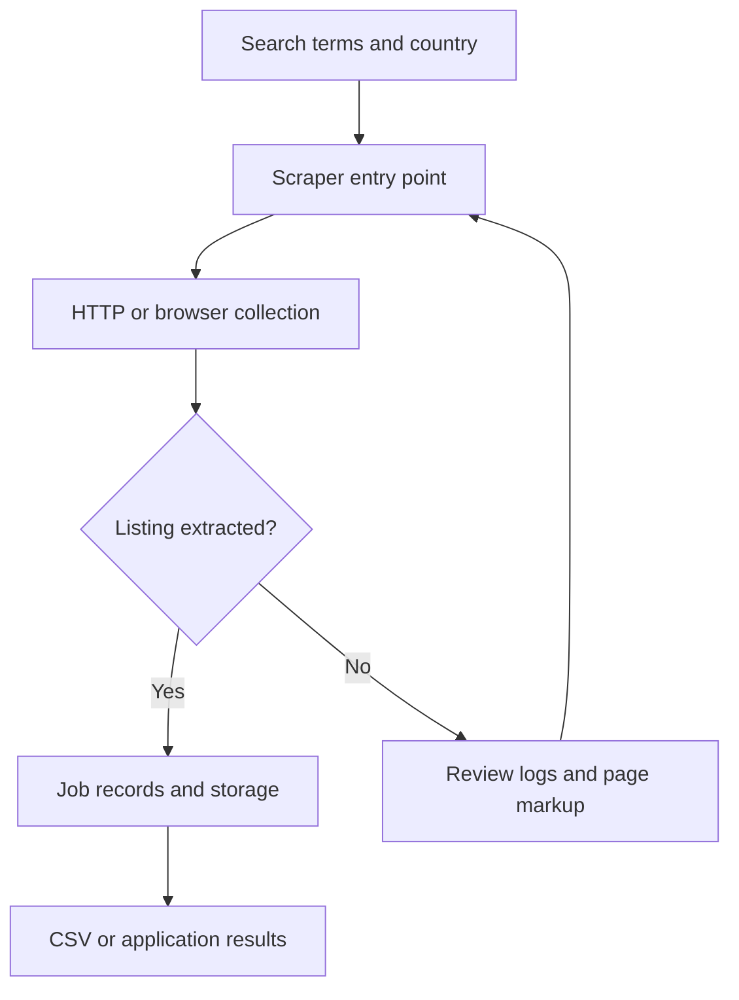

# Multi-Country Job Scraper

Python Indeed scraping prototype for collecting job listings across country domains and saving CSV results.

## Project focus

Python scraping prototype. The sections below separate the runnable entry point, source layout, prerequisites, and verification path.

## Architecture



## Repository structure

| Path | Purpose |
| --- | --- |
| [`Indeed_job_Scraper.py`](Indeed_job_Scraper.py) | Python application helper or learning example. |
| [`Multi_Country_Job_results.csv`](Multi_Country_Job_results.csv) | Dataset, fixture, state, or database file; inspect its schema before use. |
| [`requirements.txt`](requirements.txt) | Python dependency manifest. |

## Getting started

```bash
git clone https://github.com/Raimal-Raja/Advanced_Web_Crawler.git
cd Advanced_Web_Crawler
```

```bash
python -m venv .venv
source .venv/bin/activate
```

On Windows PowerShell, activate the environment with `.venv\Scripts\Activate.ps1` instead.

```bash
python -m pip install -r requirements.txt
```

```bash
python Indeed_job_Scraper.py
```

## Configuration and scope

Live collection depends on browser availability, the current page markup, site access permissions, and the configured search inputs. Access-control or anti-bot handling is not a guarantee of collection. Inspect saved records for missing fields and duplicates.

## Verification

Use the setup commands and inspect the selected interface, example, or notebook with known inputs. This documentation review checks repository paths and dependency declarations; it does not claim fresh end-to-end execution or model-quality measurements.

## Contributing

Include reproduction steps, the affected path, expected behavior, and the checks you ran. Keep credentials, generated environments, and unnecessary build artifacts out of commits.

## License

No top-level license file is currently tracked. Check reuse permissions with the repository owner.
